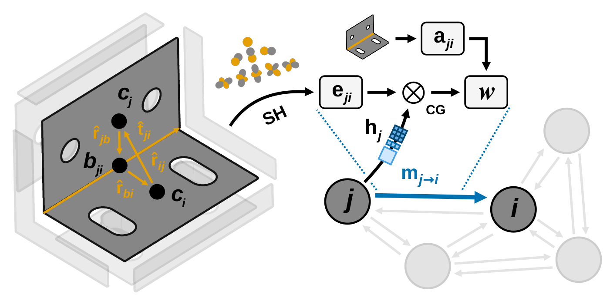

# SO3brep

[](https://github.com/UGent-CVAMO/so3brep/actions/workflows/ci.yml)
[](LICENSE)

Official code for **SO(3)-Equivariant Learning on CAD Boundary Representations**
(Matteo Ballegeer, Dries F. Benoit, NeurIPS 2026).

SO3brep is a graph neural network on the face-adjacency graph of a B-rep. Face features are
computed in local frames given by the surface parameterization and rotated into a shared frame with
Wigner D-matrices; Clebsch–Gordan tensor products couple them with the directions between adjacent
faces. Messages carry how neighbouring faces are oriented, and predictions are invariant to the pose
of the part.



## Installation

```bash
git clone https://github.com/UGent-CVAMO/so3brep.git && cd so3brep
conda env create -f environment.yml
conda activate so3brep
```

Tested on Linux with CUDA 12.1. For another CUDA version, change the PyTorch and DGL wheels in
`environment.yml`. Commands are run from the repository root.

## Quick start

```bash
bash pipeline/preprocess_all.sh --data_dir data          # STEP files -> face graphs
python -m train.train configs/benchmark/fusion360.yaml   # train, then test on original and rotated parts
python -m eval.evaluate runs/benchmark/fusion360/seed42  # score a trained run again
```

Configs only state what differs from their `base:` file; any value can be overridden, e.g.
`--set data.batch_size=16`. Add `--wandb <project>` to log to Weights & Biases.

## Data

| Dataset | Task | Parts | Classes |
|---|---|---|---|
| MFCAD++ (Colligan et al., 2022) | face segmentation | 59.6K | 25 |
| MFTRCAD (Xia et al., 2024) | face segmentation | 28.6K | 27 |
| [Fusion 360 Gallery](https://github.com/AutodeskAILab/Fusion360GalleryDataset) segmentation | face segmentation | 35.7K | 8 |
| [SolidLetters](https://github.com/AutodeskAILab/UV-Net) | classification | 96K | 26 |
| BenDFM (Ballegeer et al., 2026) | classification | 14K | 2 |

The datasets keep their own licenses and are not redistributed. Put each one under `data/<dataset>/`
with a `step/` folder and `train.txt`, `val.txt`, `test.txt` (one part id per line);
[docs/processing_your_own_data.md](docs/processing_your_own_data.md) describes the label formats,
the conversion and the graph contents.

## Reproducing the paper

| Experiment | Command |
|---|---|
| Tabs. 1–2, benchmarks | `bash train/reproduce_tab1_tab2.sh` |
| Tab. 3, message functions | `bash train/reproduce_tab3.sh` |
| Fig. 4, ablations | `bash train/reproduce_fig4.sh` |
| Tab. 4, computational cost | `bash train/reproduce_tab4.sh` |
| Fig. 3, data efficiency | `bash train/reproduce_fig3.sh` |
| Sec. 4.5, equivariance error | `python -m eval.equivariance runs/benchmark/solidletters/seed42` |

Each script trains five seeds and prints mean ± std (`python -m eval.tables runs`). Scores vary with
the seed, GPU and library versions.

## Using the model

```python
from models import SO3brep
from dataloaders import collate_pyg

net = SO3brep(num_classes=8, segmentation=True)   # 0.40 M parameters
logits = net(collate_pyg(items)["graph"])         # items from dataloaders.BRepGraphs
```

`message` selects the message function (`cg`, `attention`, `concat`, `invariant`); `l_max`,
`surface_attrs`, `uv_grid`, `rays`, `attention`, `use_node_features` and `use_edge_features` give
the ablations.

## Citation

```bibtex
@inproceedings{ballegeer2026so3brep,
  title     = {{SO(3)}-Equivariant Learning on {CAD} Boundary Representations},
  author    = {Ballegeer, Matteo and Benoit, Dries F.},
  booktitle = {Advances in Neural Information Processing Systems},
  year      = {2026}
}
```

This research was supported by Flanders Make, the strategic research centre for the Flemish
manufacturing industry.
