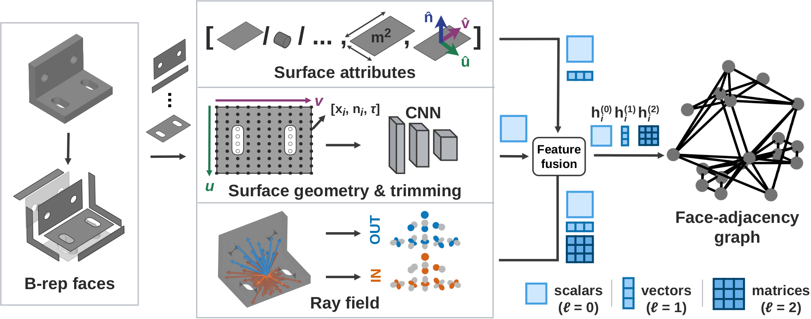

# Processing your own data

[`pipeline/preprocess.py`](../pipeline/preprocess.py) converts STEP files into the face-adjacency
graphs that SO3brep reads. It needs `pythonocc-core`, which is part of `environment.yml`.

## Folder layout

Put the parts of a dataset in one folder:

```
my_dataset/
  step/<id>.step                 one solid per file
  train.txt  val.txt  test.txt   one part id per line
```

For face segmentation, the labels are read in the format of the dataset given with `--dataset`:
face names in the STEP file (`mfcad++`), `seg/<id>.seg` with one label per face in the order of the
STEP faces (`fusion360`), or `labels/<id>.json` holding `{"cls": {face index: label}}` (`mftrcad`).
Faces without a label get `-1` and are ignored by the loss and the scores.

## Conversion

```
python -m pipeline.preprocess --root my_dataset --dataset fusion360 --split all --workers 8
python -m pipeline.preprocess --root my_dataset --dataset fusion360 --split test --rotate --workers 8
```

The first command writes `my_dataset/graphs/so3brep/<id>.bin` for every part. The second one
writes rotated copies of the test parts to `graphs_rotated/so3brep/<id>_rotated.bin` and
`step_rotated/<id>_rotated.stp`; the rotation of each part is seeded by its id, so it is the same on
every run. Each part is processed in its own process and killed after `--timeout` seconds (default
300); `--skip_existing` resumes an interrupted conversion.

To train on a new segmentation dataset, add an entry with its number of classes to `DATASETS` in
[`dataloaders/datasets.py`](../dataloaders/datasets.py) and point a config at the folder. For a
classification dataset, also return its part labels in `BRepGraphs.part_label`.

```yaml
data:
  dataset: my_dataset
  root: /path/to/my_dataset
```

## Graph contents



Every part is scaled to unit radius. A graph has one node type `face` and one edge type `adj`, with
both directions of every adjacency.

| Field | Shape | Content |
|---|---|---|
| `ndata["x_local"]` | F × 10 × 10 × 7 | UV grid of the face in its local frame: points, normals, trimming mask |
| `ndata["center_nuv"]` | F × 12 | face centre, normal, u axis and v axis of the local frame (world frame) |
| `ndata["face_feat"]` | F × 7 | plane, cylinder, cone, sphere, torus flags, face area, rational surface flag |
| `ndata["vision_grids"]` | F × 6 × 12 × 6 | rays over the outward and inward hemisphere: hit, distance, normal dot product |
| `ndata["y"]` | F | face labels (segmentation datasets) |
| `edata["x"]` | E × 10 × 12 | samples of the shared curve: points, tangents and the normals of both faces |
| `edata["edge_feat"]` | E × 10 | convexity, length, curve type and closed flags |
| `edata["edge_mid"]` | E × 3 | parametric midpoint of the shared curve |

The local frame of a face is anchored at the middle of its parameter range: the u tangent, the
outward normal and their cross product. Rays are cast on a Fibonacci grid that is fixed in this frame.
